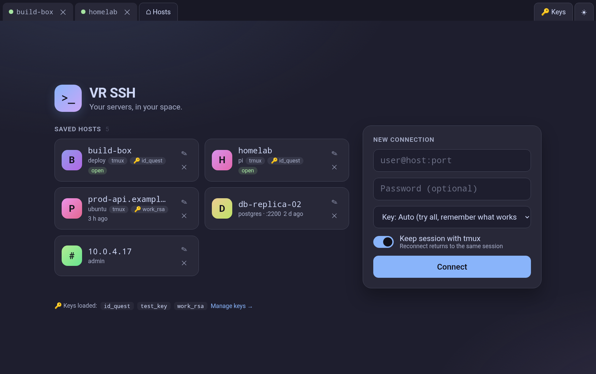
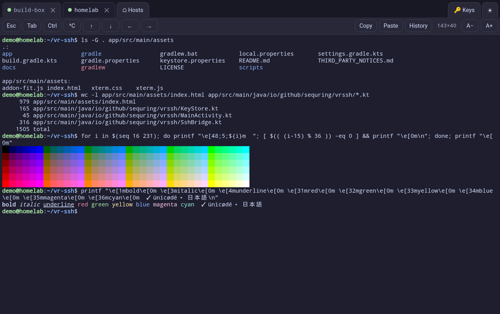
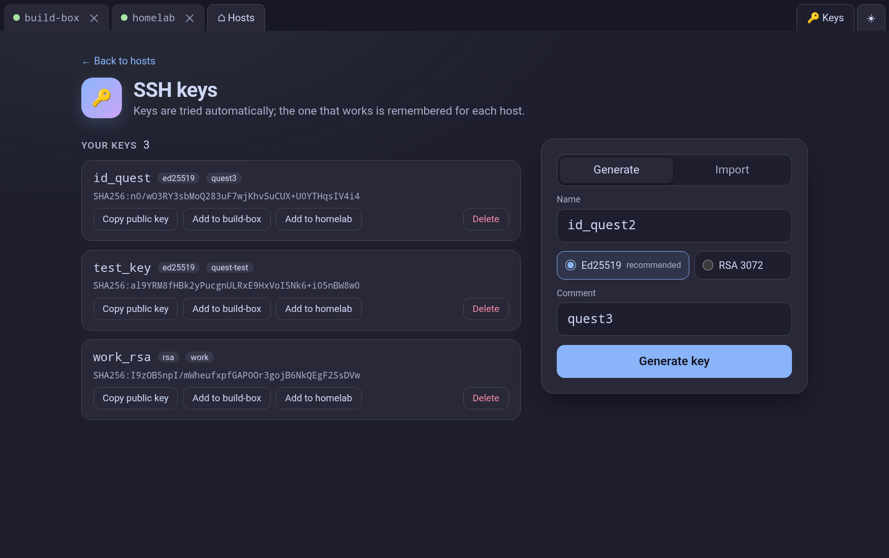

# VR SSH

A full SSH terminal for Meta Quest headsets. Runs as a native panel app in Horizon OS and connects to your servers directly from the headset — no computer in the middle.



## Features

- **Real terminal** — [xterm.js](https://xtermjs.org/) with 256 colors, mouse, `vim`, `htop`, `tmux`, Unicode.
- **Tabs** — several sessions side by side; `Ctrl+Shift+T` / `Ctrl+Shift+W` / `Ctrl+Tab`.
- **Auto-reconnect** — when Wi-Fi drops or the headset sleeps, tabs reconnect with backoff (1 → 30 s). Optional **tmux** mode brings you back to the very same session.
- **SSH keys** — generate Ed25519 / RSA on the headset, import from clipboard (OpenSSH and PEM), copy the public key, or append it to `authorized_keys` on a connected server in one tap. The key that works is remembered per host.
- **Copy & paste** through the system clipboard, between tabs and other apps.
- **Command history** shared across tabs, with search. Commands are read from the screen, so passwords typed at hidden prompts are never stored.
- **Special keys bar** — Esc, Tab, sticky Ctrl, ^C, arrows — for typing with the virtual keyboard.
- **Light and dark themes** (Catppuccin Latte / Mocha), adjustable font size.

| Terminal | Keys |
|---|---|
|  |  |

## Install

1. Enable [developer mode](https://developers.meta.com/horizon/documentation/native/android/mobile-device-setup/) on the headset.
2. Download the APK from [Releases](https://github.com/sequring/vr-ssh/releases).
3. Install it with [SideQuest](https://sidequestvr.com/), Meta Quest Developer Hub, or adb:
   ```bash
   adb install vr-ssh-1.0.0.apk
   ```
4. In the headset: **Library → Unknown Sources → VR SSH**.

A Bluetooth keyboard paired with the headset makes it a comfortable workstation.

### Adding an existing key from your computer

Either paste it on the **Keys** page, or push it over USB:

```bash
adb push ~/.ssh/id_ed25519 /sdcard/Android/data/io.github.sequring.vrssh/files/ssh/
```

## Security notes

- Private keys are stored in the app's private storage on the headset, **unencrypted** unless the key itself has a passphrase. Prefer a dedicated key for the headset over copying your main one.
- Host keys are trusted on first use and pinned afterwards; a changed host key aborts the connection.
- Passwords are kept in memory only for the open tab (to reconnect) and are never written to disk.
- The app collects no data and talks only to the servers you connect to — see the [Privacy Policy](PRIVACY.md).

## Build

Requirements: JDK 17 and the Android SDK (platform 34).

```bash
./gradlew assembleDebug          # app/build/outputs/apk/debug/app-debug.apk
./gradlew installDebug           # build and install on a connected headset
```

Release builds are signed with a key from `keystore.properties` (not in the repo, see `app/build.gradle.kts`); `scripts/release.sh` builds, verifies, tags and publishes a GitHub release.

### Project layout

```
app/src/main/
├── assets/index.html          UI: hosts, tabs, terminal, keys, history
├── java/.../MainActivity.kt   WebView host
├── java/.../SshBridge.kt      SSH sessions (JSch), reconnect, clipboard
└── java/.../KeyStore.kt       key generation / import / listing
```

## License

[MIT](LICENSE). Bundled third-party components are listed in [THIRD_PARTY_NOTICES.md](THIRD_PARTY_NOTICES.md).
